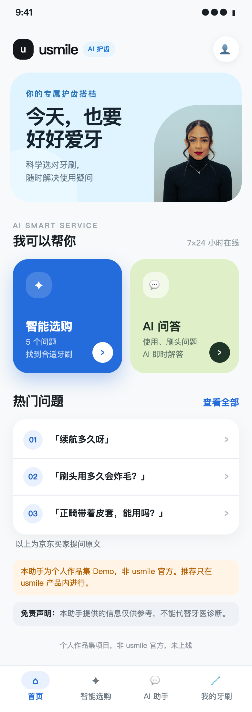
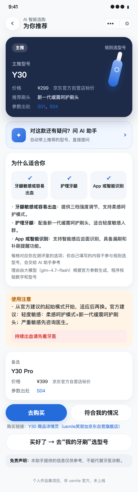
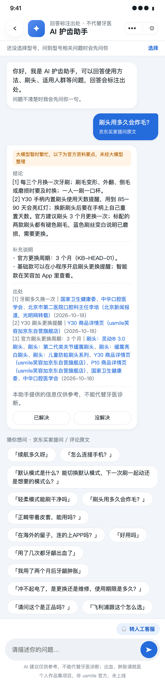
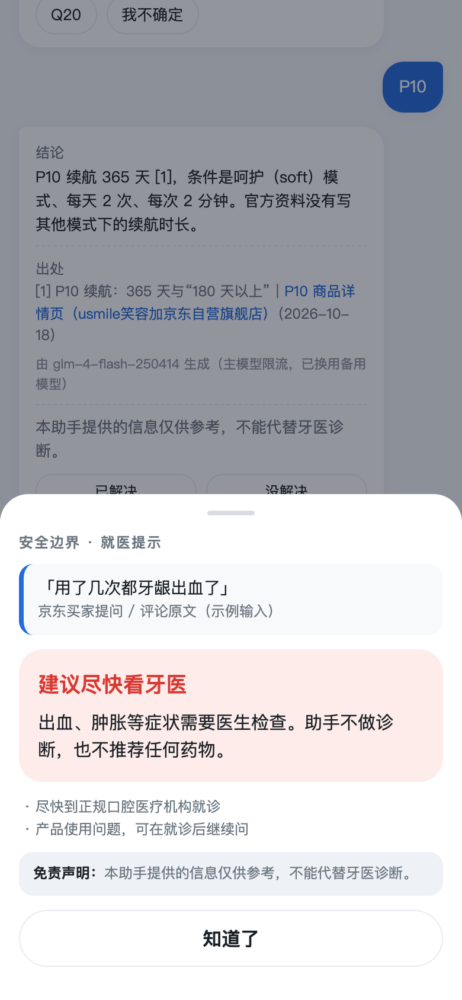

> **个人作品集项目，非 usmile 官方需求，与 usmile 无合作关系，未上线。**

# usmile AI 护齿助手（用户洞察 → PRD → RAG Demo → 评测迭代）

作者：范欣乐（Melody）

用京东公开评论和买家提问，找出电动牙刷用户的痛点，判断哪些适合用 AI 解决；据此定义一个微信小程序形态的“AI 护齿助手”，写出 PRD，做出带出处、会拒答的 RAG Demo，并用自建评测集迭代一轮。

<p>




</p>

## 结果一览

所有数字都来自本仓库里真实跑出来的结果。样本小，结论只作方向性参考。

| 环节 | 结果 | 详见 |
|---|---|---|
| 数据 | 京东 6 个型号（usmile 3 款 + 3 个竞品）：评论 178 条，去重后 171 条；买家提问 118 条 | [METHODS 第 0–1 步](docs/METHODS.md) |
| LLM 打标签 | 两层标签（功能标签 + 需求主题）。人工抽检 50 条：完全正确 88%，功能标签和情感 100%。“AI 能缓解”字段第二批抽检 95% | [标签定义](docs/tag_schema.md)、METHODS 第 3–4 步 |
| 痛点分析（SQL） | 负面最多的是质量故障、使用方法、性价比（23 / 20 / 20 条）。有负面反馈的评论中，只有 28% 适合 AI 解决，且集中在使用方法上（该类负面 70% 可由 AI 指导缓解）；买家提问中 66% 可由 AI 直接回答 | [洞察](docs/insights.md)、[sql/analysis.sql](sql/analysis.sql) |
| 产品定义 | 微信小程序是所有 usmile 用户的轻入口：售前 5 题定制选购（规则选型号，大模型只解释理由），购后问答；智能款的设备功能交给已有的笑容加 App，不重复做 | [概念卡](docs/concept_card.md)、[PRD](docs/PRD_v1.0.md) |
| 知识库 | 85 个知识块，只用品牌官方资料和权威口腔科普，每块带来源和抓取日期；找不到的写“待核实” | [kb/](kb/)、[来源清单](kb/sources.md) |
| 评测 | 自建 25 题，与 PRD 验收标准一一对应，其中 6 题应拒答或转向。安全 6/6、医疗违规 0；规则类 16/16；推荐一致性 10 次运行结果相同。问答 8 题加权分：v1 76.3 → v2 86.5；正确性达标（≥ 4 分）4/8 → 5/8，**未达到 80% 的目标** | [评测对比](eval/review_v2.md)、[bad case](docs/badcase_log.md) |

## 怎么运行

```bash
python3 -m venv .venv
.venv/bin/pip install -r requirements.txt
cp .env.example .env          # 填入智谱 Key；不填也能跑，问答会进入 mock 模式并在界面标明
.venv/bin/uvicorn src.api:app --port 8000
```

打开 http://127.0.0.1:8000/ 是 Demo 页面（网页模拟小程序），http://127.0.0.1:8000/docs 可以直接试接口。接口说明见 [docs/API.md](docs/API.md)。

- 测试：`.venv/bin/python -m pytest`
- 评测：`.venv/bin/python eval/run_eval.py`
- 引用核对（引号里必须是原文）：`.venv/bin/python src/check_quotes.py <文件>`

分析部分（清洗、打标签、SQL）依赖原始评论数据，原始数据不公开，所以这部分只能看代码和 `results/` 里的统计结果。

## 技术方案

- 打标签：智谱 GLM-4-Flash（免费），每条评论单独调用，要求给出原文证据，程序核对证据是否为原文子串。
- 问答：bge-small-zh 向量化 + FAISS 检索 + GLM-4.7-Flash 生成（关闭思考模式），主模型限流时自动换备用模型。
- 规则先于大模型：选型号、按型号分流、安全边界（不诊断、不推药、急症只提示就医、售后和真伪转官方客服、不评价竞品）都由规则完成。
- 防编造：回答必须带出处；功效类说法和“默认是…”类结论必须出现在被引用的原文里，否则改为展示官方资料要点。
- 后端是 FastAPI 接口，前端是网页。以后换成真实小程序只需要重写前端。

## 目录

```
docs/        PRD、概念卡、洞察、方法记录（METHODS）、决策日志（DECISIONS）、bad case、截图
sql/         所有分析 SQL
results/     SQL 统计结果和痛点矩阵（只有数字）
src/         清洗、打标签、分析、知识库、Demo 后端（src/core、src/api.py）
kb/          知识库（官方资料 + 权威科普，带来源）
web/         Demo 前端
eval/        评测题对照、评测脚本和结果
prototype/   可点击原型和截图
tests/       单元测试（测试用假数据只在这里，并已标注）
```

## 数据与诚实说明

- 只用公开数据：京东公开评论和买家提问、品牌官方页面、权威口腔科普。不包含任何 usmile 内部数据（销量、客服量、转化率、App 数据）；需要内部数据的地方都写成【假设】或【待验证】。
- 原始评论和含全文的数据库不放进仓库；仓库里只有代码、统计结果和少量短引用，引号里的用户原话都是原文，未改写。
- 采集时没有保存昵称、头像、用户 ID、订单号等个人信息。
- Demo 中演示“App → 小程序数据同步”的一屏使用的是模拟设备数据，页面上已标注“模拟设备数据，仅作演示，非真实用户”。
- 局限：只有京东一个平台；中差评是刻意多抽的，比例不代表全体用户；评测只有 25 题，是回归测试，不能证明统计意义上的效果；同一题多次运行结果会有波动。
- 没有上线：用 usmile 名义公开上线涉及品牌授权，健康类 AI 问答也有合规要求。

## 方法参考

PM 方法参考 [Product-Manager-Skills](https://github.com/deanpeters/Product-Manager-Skills)（deanpeters，CC BY-NC-SA 4.0）中的 voice-of-customer-miner、epic-hypothesis、prd-development、user-story、derisk-measurement-advisor，只借用方法，表述为本项目自写。实现过程使用 Claude Code。
