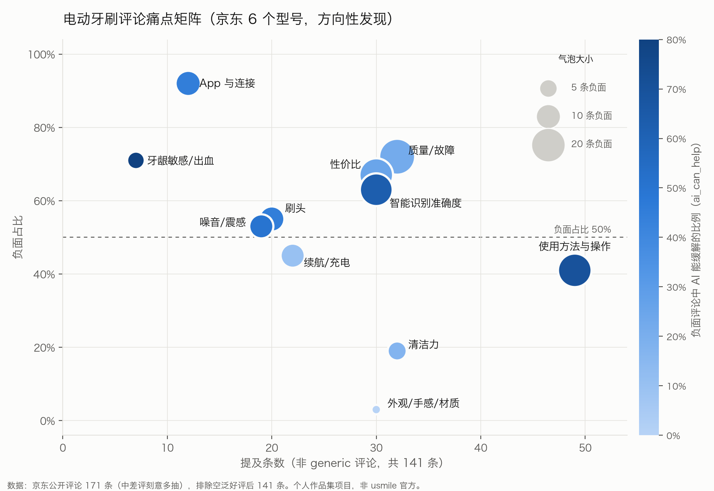

# 痛点洞察 v1.0（第 ⑥ 步，需求主题 Melody 2026-10-16 确认，D22）

> 个人作品集项目，非 usmile 官方。所有结论是**方向性发现**，需要用真实业务数据（客服工单、App 搜索词）验证。
> 方法参考 voice-of-customer-miner（Product-Manager-Skills，deanpeters，CC BY-NC-SA 4.0）：按需求而不是按功能归类、频次如实标注、引用原话、注明来源偏差、列出待验证假设。表述为本项目自写。
> 引号里都是京东评论或买家提问的原文片段（未改写），括号里是编号；数字来自 `sql/analysis.sql`，结果在 `results/`。

## 1. 范围

| 项目 | 内容 |
|---|---|
| 数据 | 京东公开评论 171 条（6 个型号：usmile Y30 / P10 / U7 Pro、飞利浦 HX9996/12、欧乐B iO7、米家 T302），买家提问 118 条 |
| 分析样本 | 排除空泛/模板好评（generic）后 141 条；有负面反馈的 98 条 |
| 支撑的决策 | 护齿问答助手应该解决哪些问题、不解决哪些问题（D21） |
| 日期 | 2026-10-16 |

## 2. 需求主题（第二层，已确认）

按“用户真正想要什么”归类。频次标注：**反复出现** = 多个型号都有；**集中出现** = 主要来自一个型号或一个时期；**个别** = 条数很少。

### 主题 A：想知道“我该怎么用才对”
- **频次**：反复出现。“使用方法与操作”负面 20 条，覆盖 5 个型号；其中 70% 是 AI 能缓解的（ai_can_help），45% 是缺信息导致的（info_need）。
- **原话**：「本来使用时不知道后来买了其他产品才知道换挡震动有区别」(R148)
- **原话**：「最小的档位自然感觉力度有点大，不适合刚使用电动牙刷的人」(R146)
- **原话**：「开关按钮靠下，那个点就很不好找」(R088)
- **解读**（推断）：问题不在功能少，而在用户不知道该用哪个模式、哪个档位，新手尤其明显。

### 主题 B：想知道“智能提醒准不准、该不该信”
- **频次**：集中出现。“智能识别准确度”负面 19 条，其中 14 条来自 U7 Pro，12 条是 2024 年的评论；只看近 12 个月只剩 4 条。
- **原话**：「识别不准确左右牙老是弄混」(R065)
- **原话**：「想要识别度高一点就要用特定的刷牙姿势」(R155)
- **原话**：「是APP的问题还是牙刷本身识别能力差导致的？」(R114)
- **反面**：也有 10 条正面，例如「改善了我不少的刷牙陋习」(R055)。
- **解读**（推断）：智能功能有价值，但用户不清楚它的边界，也不知道怎么配合它刷。这个痛点可能已经通过固件更新改善了【待验证】。

### 主题 C：牙龈敏感或刚开始用，怕伤牙
- **频次**：个别到反复之间。牙龈敏感/出血或刷毛偏硬的负面 9 条，覆盖 5 个型号，条数少。
- **原话**：「用了几次都牙龈出血了」(R146)
- **原话**：「我用了两个月后牙龈肿胀，不敢用电动的」(R081)
- **解读**（推断）：这类用户需要“温和的刷法”和“选什么刷头”的指导；涉及出血、肿胀，回答必须有医疗边界（不诊断、建议就医）。

### 主题 D：买之前想搞清楚“哪款适合我”
- **频次**：反复出现。118 条买家提问中，选购对比 20 条、适用人群 13 条、产品参数 14 条，共 47 条，覆盖 5 个型号（U7 Pro 只有 2 条提问，样本缺口）。这三类 AI 都能直接回答。
- **原话**：「y30和p20pro推荐哪个」(Q013)
- **原话**：「正畸带着皮套，能用吗？」(Q089)
- **原话**：「以为是那种超声波牙刷，用来才知道是一个能自己摆头的牙刷」(R009)
- **解读**（推断）：选购阶段的问题有确定答案，最适合问答助手先做。

### 主题 E（不做）：东西坏了、买贵了，希望被公平对待
- **频次**：反复出现，而且是负面最多的一类。质量/故障、性价比、客服售后、价格变动的负面评论共 55 条。
- **原话**：「没用两天就故障，开关键都没反应」(R158)
- **原话**：「买了不到一周就降价」(R110)
- **解读**（推断）：这些要靠改进产品、售后和价格政策来解决，只提供信息的问答助手解决不了。写进 PRD“不做什么”。

## 3. 洞察（3–5 条）

1. **AI 能帮上的范围是明确且有限的。** 98 条有负面反馈的评论中，AI 能缓解的占 28%（27 条），缺信息导致的占 11%（11 条）；剩下 72%（71 条）AI 帮不上，主要是质量、售后、价格问题。所以助手应该定位成“使用和选购指导”，不是“解决所有不满”。
2. **最大的 AI 机会是“使用方法”。** 它在矩阵右侧（提及 49 条，最多），负面中 70% AI 能缓解，属于“提及多 + AI 能帮”的区域。用户缺的是“我该用哪个模式和档位”。
3. **选购问题最适合先做。** 买家提问中 AI 能直接回答的占 66%（78/118）；选购对比、产品参数、适用人群三类全部能答。主观的“好用吗”（25 条）答不了，不做。
4. **智能识别的抱怨要谨慎解读。** 负面高度集中在 U7 Pro 的 2024 年评论，近 12 个月明显减少。助手能做的是讲清楚智能识别怎么用、准确度的边界，而不是承诺“更准”。
5. **敏感牙龈是小众但高风险的场景。** 条数少（9 条），但 ai_can_help 占比高（牙龈敏感负面中 80%），而且涉及出血、肿胀。这是体现医疗边界设计（不诊断、急症就医、免责声明）的场景，适合放进评测集的拒答题。

## 4. 来源偏差

| 来源 | 偏差 | 怎么读 |
|---|---|---|
| 京东评论 | 只有一个平台；中差评刻意多抽到 50%；有刷单好评 | 不看整体好评率；比例只在过滤后的样本内看排序和量级 |
| 时间 | 约 1/3 早于近 12 个月；U7 Pro 只有 31% 是近一年，HX9996/12 48% | 型号对比要注明；智能识别结论做了近 12 个月的敏感性检查 |
| 买家提问 | 不含回答正文；U7 Pro 只有 2 条 | U7 Pro 的选购需求无法判断 |
| LLM 标注 | 功能标签和情感抽检 100%；info_need 90%，ai_can_help 95%；claim_gap 80%，不报比例 | 比例有误差，结论看方向 |

## 5. 待验证的假设

| # | 假设 | 用什么数据验证 |
|---|---|---|
| H1 | 客服咨询中“怎么用、选哪个模式或档位”的问题占比不低于评论里的水平 | 客服工单分类【待验证，需要 usmile 内部数据】 |
| H2 | 用户在 App 内会搜索使用方法类问题，而不只是在评论里抱怨 | App 搜索词、帮助中心点击 【待验证】 |
| H3 | U7 Pro 智能识别的抱怨在固件更新后已经下降 | 近期评论、固件版本和投诉的时间对照 【待验证】 |
